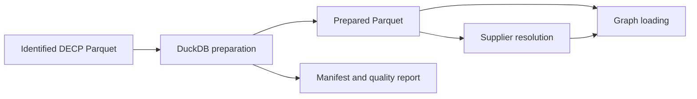
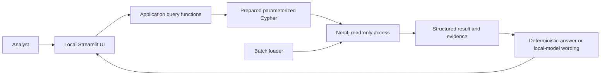
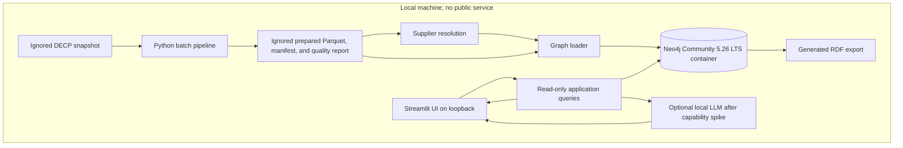

# Architecture Spine — MarchéGraph DECP

## Design Paradigm

Use one Python repository and one local application, divided into modules
around data preparation, entity resolution, graph operations, application
queries, and the Streamlit interface. Run the batch pipeline and UI as separate
commands; do not split the application into networked microservices. Neo4j is
the one separate local database service. Dependencies point inward to shared
domain and query contracts, not from data or graph code into the UI.

## Invariants & Rules

### AD-1 — Reproducible analytical data contract [ADOPTED]

- **Binds:** R1, R2, R5, R7; C1–C4
- **Prevents:** Downstream work using different snapshots, counting rules, or
  undocumented transformations.
- **Rule:** Treat the identified Parquet snapshot as immutable input. Use
  DuckDB for preparation and emit local prepared Parquet, a provenance
  manifest, and a quality report as the handoff contract. Initial-award
  statistics filter `modification_id = 0` and count distinct `uid`; keep
  modifications separately analyzable. Do not silently drop records for
  profiling anomalies.



### AD-2 — One operational graph source of truth [ADOPTED]

- **Binds:** R3, R7; C6, C8
- **Prevents:** Neo4j and RDF becoming separately edited graphs that diverge.
- **Rule:** Neo4j Community 5.26 LTS is the operational graph and the only
  mutable graph source of truth. Generate RDF exports from Neo4j using the
  ontology and mapping approved by the user; never maintain the export as a
  second write path. The graph epic owns the mapping and repeatable validation
  contract.

### AD-3 — Evidence-bound, read-only application queries [ADOPTED]

- **Binds:** R3, R4, R6
- **Prevents:** Free-form input or model output issuing arbitrary database
  commands, and answers losing their connection to graph evidence.
- **Rule:** Streamlit calls application query functions backed by prepared,
  parameterized Cypher. The UI has read-only graph access; only the batch
  pipeline writes, in a separate command and process. Query results include
  application-owned evidence references from the graph. A local language
  model may be selected only after a capability spike, may formulate French
  prose only from structured results, and may not generate or execute Cypher;
  evidence references come from the query result, not the model. Otherwise
  return deterministic answers or abstain. Never call a remote LLM service.



### AD-4 — Local-only runtime and data [ADOPTED]

- **Binds:** R1, R4, R6; C7
- **Prevents:** Accidental publication, external exposure of local services, or
  leakage of DECP-derived prompt context.
- **Rule:** Run the pipeline, Neo4j, Streamlit, and any selected language model
  locally. Bind Streamlit and Neo4j ports to loopback only; disable Neo4j usage
  reporting. Keep raw and prepared data, database volumes, credentials, and
  derived row-level outputs out of Git and out of public releases. Do not
  deploy to production or send DECP-derived context to remote services.

### AD-5 — Dependency direction [ADOPTED]

- **Binds:** all
- **Prevents:** UI, database, or infrastructure choices leaking into
  transformation and domain logic and creating incompatible epic
  implementations.
- **Rule:** Domain and data contracts are independent of Streamlit and Neo4j
  drivers. Pipeline, graph adapters, and query functions depend on those
  contracts; only database and framework adapters import their respective
  external libraries.

```mermaid
flowchart TD
  contracts["Domain and data contracts"]
  pipeline["Batch pipeline"]
  graph["Neo4j and RDF adapters"]
  queries["Application query functions"]
  ui["Streamlit UI"]
  pipeline --> contracts
  graph --> contracts
  queries --> contracts
  queries --> graph
  ui --> queries
```

## Consistency Conventions

| Concern | Convention |
| --- | --- |
| Naming and identity | Preserve source field names at ingestion boundaries. Keep `uid` and external identifiers as strings so leading zeros and source identity are not lost. |
| Data and formats | Treat dates as source dates and monetary amounts as exact decimal values, not binary floating point. Prepared Parquet is the downstream data handoff; RDF is a generated export from Neo4j. |
| Quality and errors | Report invalid or anomalous records with the rule and stable source identifier when available. Fail visibly on pipeline, validation, or database errors; do not silently substitute empty or success-shaped results. |
| Configuration and credentials | Read local paths and Neo4j credentials from local configuration/environment; commit no credentials. Keep data, database volumes, and generated outputs ignored by Git. |
| Query and evidence | Keep Cypher in application-owned, parameterized query functions. Return evidence references alongside result values; an LLM cannot invent or replace them. |

## Stack

| Name | Version |
| --- | --- |
| Python | 3.12.3 |
| DuckDB | 2.0.0 |
| Neo4j Community | 5.26 LTS |
| Neo4j Python Driver | 6.4.1 |
| Docker Engine | 29.4.1 |
| Docker Compose | 5.1.3 |
| Streamlit | 1.66.1 |

## Structural Seed



```text
marchegraph/
  data/                       # ignored raw snapshot and local data
  data/prepared/              # ignored prepared Parquet, manifest, and report
  src/marchegraph/
    data/                     # DuckDB preparation and quality reporting
    entity_resolution/        # supplier matching and measurement
    graph/                    # Neo4j writes, reads, and generated RDF export
    queries/                  # parameterized application query functions
    app.py                    # local Streamlit interface
  tests/                      # focused module and integrated checks
  compose.yaml                # local Neo4j service definition
```

## Capability → Architecture Map

| Capability / Area | Lives in | Governed by |
| --- | --- | --- |
| R1–R2: reproducible analytical data and distinct initial-award counts | `src/marchegraph/data/` | AD-1, AD-5; data and quality conventions |
| R5: supplier identity resolution and measured quality | `src/marchegraph/entity_resolution/` | AD-1, AD-5; local-only convention |
| R3, R7: approved model, graph, reference queries, and validation | `src/marchegraph/graph/`, `src/marchegraph/queries/` | AD-1–AD-3, AD-5 |
| R4, R6: local evidence-backed assistant and evaluation | `src/marchegraph/queries/`, `src/marchegraph/app.py`, `tests/` | AD-3–AD-5 |

## Deferred

- The user decides the ontology's concepts, relationships, and modeling
  trade-offs, including modifications and awards with multiple holders; settle
  these in the graph epic before fixing the graph-to-RDF mapping.
- Select the exact RDF mapping and validation shapes with the user's approved
  model; the architecture fixes only that RDF is generated from Neo4j.
- Select the RDF serialization and SHACL validation libraries when the graph
  epic refines its user-approved model.
- Select and run a local language-model capability spike before choosing any
  model or runtime. If local inference is not viable, keep deterministic
  responses and return to the user to reconcile the R4/R6 acceptance scope;
  do not silently drop those requirements or substitute a remote API. Use the
  same locally evaluated model for GraphRAG and no-graph baseline comparisons.
- Set the answer-quality threshold after measuring the agreed baseline.
- Deployment beyond the local learning/demo environment remains out of scope.

## References

- parent — [`initiative-marchegraph-decp.md`](../initiative-marchegraph-decp.md), Requirements R1–R7; Constraints C1–C8.
- existing code — [`profilage_01.py`](../../../src/profilage_01.py).
- existing prototypes — [`ontologie.ttl`](../../../docs/exemple/ontologie.ttl), [`formes.ttl`](../../../docs/exemple/formes.ttl), [`neo4j.cypher`](../../../docs/exemple/neo4j.cypher).
- verified technology — [Neo4j Operations Manual 5.26](https://neo4j.com/docs/operations-manual/5/installation/); [Neo4j Python Driver compatibility](https://neo4j.com/docs/python-manual/current/install/); [DuckDB 2.0 documentation](https://duckdb.org/docs/2.0/); [Streamlit chat interface](https://docs.streamlit.io/develop/tutorials/chat-and-llm-apps/build-conversational-apps); [Streamlit local execution](https://docs.streamlit.io/get-started/fundamentals/main-concepts).
