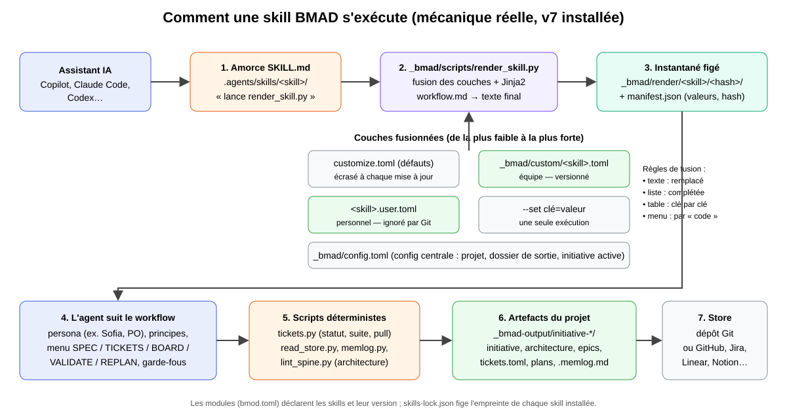
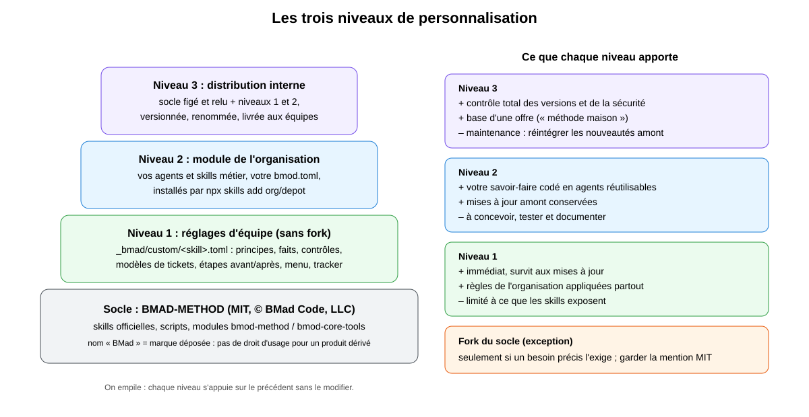
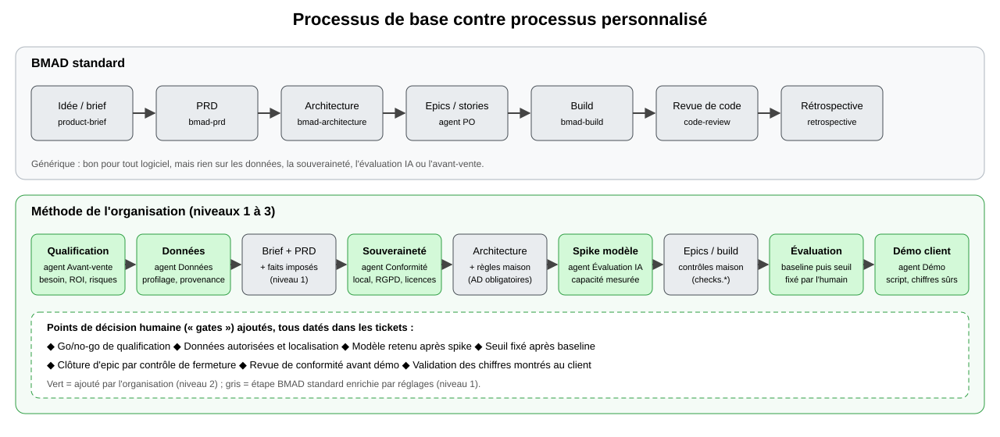
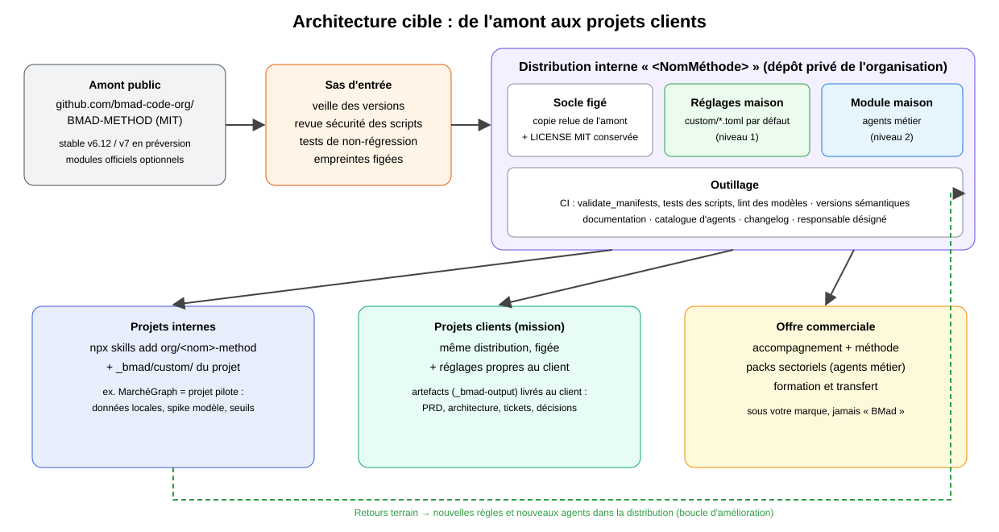

# Faire de BMAD notre méthode : personnaliser, étendre, distribuer

Document de travail pour une présentation au management. Il s'appuie sur
l'installation réelle de BMAD dans le projet MarchéGraph (version
`6.13.0-next`, ligne v7) et sur la documentation publique du projet
`bmad-code-org/BMAD-METHOD`. Les schémas sont dans `images/`.

---

## 0. Résumé en une page

- **Ce qu'est BMAD.** Une méthode de développement assisté par IA, livrée sous
  forme de « skills » : des agents spécialisés (Product Owner, architecte,
  développeur…) et des workflows qui transforment une idée en tickets, en
  architecture et en code, en gardant les décisions humaines explicites et
  tracées.
- **Ce qu'on peut en faire.** Le code est sous **licence MIT** : nous pouvons
  l'utiliser, le modifier, le redistribuer et le vendre, à condition de garder
  la mention de copyright. Le **nom « BMad » est une marque déposée** : notre
  version porte notre propre nom.
- **Comment.** Trois niveaux, empilés :
  1. **Réglages d'équipe** (sans toucher au code) : nos règles appliquées par
     tous les agents.
  2. **Module maison** : nos propres agents métier (avant-vente, données,
     conformité, évaluation IA, démo).
  3. **Distribution interne** : une version figée, relue et renommée, livrée
     aux équipes et aux clients.
- **Pourquoi c'est crédible.** MarchéGraph a servi de pilote : quatre epics
  livrés avec traçabilité des décisions, un spike de modèle local, une
  évaluation avec baseline et seuil fixé par l'humain. Ce sont précisément les
  règles que nous voulons généraliser.
- **Ce que nous demandons.** Un pilote de 30 jours sur les niveaux 1 et 2,
  un responsable de la distribution, et un avis juridique sur la marque.

---

## 1. Comprendre BMAD

### 1.1 Le principe

Un assistant de code seul transforme vite des hypothèses non dites en code.
BMAD intercale une **méthode** : chaque étape (brief, PRD, architecture,
découpage, build, revue) est portée par un agent spécialisé qui pose les
questions, écrit des artefacts versionnés et **laisse l'humain décider**.
Chaque décision est datée dans le ticket concerné (`Decision:`), chaque
question non tranchée aussi (`Open question:`).

### 1.2 Vocabulaire

| Terme | Sens |
|---|---|
| Skill | Un dossier qui enseigne une tâche à l'assistant : `SKILL.md`, `workflow.md`, références, modèles, scripts. |
| Agent | Une skill avec une persona (nom, rôle, principes, menu). Ex. Sofia, Product Owner. |
| Module (`bmod`) | Un ensemble de skills versionné, décrit par un `bmod.toml`. Ex. `bmod-method` (méthode), `bmod-core-tools` (outils). |
| Initiative | Un projet de bout en bout : exigences R1…Rn, contraintes, epics. Joue le rôle du PRD. |
| Epic, story | Découpage en livrables ; chaque story a un critère « fait quand ». |
| Store | L'endroit où vivent les tickets : le dépôt Git ou un outil (GitHub, Jira, Linear, Notion, Trello). |
| hitl | « Humain dans la boucle » : une étape qui exige une décision humaine. |

### 1.3 Les agents et skills fournis (module `bmod-method`)

Analyste, PM, Product Owner, architecte, designer UX, développeur ; skills de
brief, PRD, PR-FAQ, architecture, UX, build (manuel et autonome), revue de
code, tests E2E, rétrospective, contexte projet, visite guidée. Plus la skill
`bmad` : conseil, installation, mises à jour, initiative active.

Dans MarchéGraph, seuls `bmad`, `bmad-agent-po`, `bmad-architecture`,
`bmad-prd` et `bmad-product-brief` sont installés.

---

## 2. Comment ça marche vraiment



### 2.1 Le chemin d'exécution, étape par étape

1. **L'amorce.** `.agents/skills/bmad-agent-po/SKILL.md` ne contient presque
   rien : une description (pour que l'assistant sache quand l'utiliser) et
   l'ordre de lancer une commande :
   `uv run _bmad/scripts/render_skill.py --project-root … --skill …`.
2. **La fusion des réglages.** Le script charge, dans cet ordre :
   - `customize.toml` de la skill : les défauts, **écrasés à chaque mise à
     jour** ;
   - `_bmad/custom/<skill>.toml` : les réglages de l'équipe, **versionnés** ;
   - `_bmad/custom/<skill>.user.toml` : les préférences personnelles,
     **ignorées par Git** ;
   - d'éventuels `--set clé=valeur` pour une exécution ;
   - et la configuration centrale `_bmad/config.toml`.

   Règles de fusion : un texte est **remplacé**, une liste est **complétée**,
   une table est fusionnée **clé par clé**, et les entrées de menu sont
   fusionnées **par leur `code`**.
3. **Le rendu.** `workflow.md` est un modèle Jinja2 : `{{ agent.principles }}`,
   `{{ agent.menu }}`, conditions, `halt(...)` si un réglage est invalide. Le
   résultat est écrit dans un **instantané figé**
   `_bmad/render/<skill>/<projet>/<hash>/`, avec un `manifest.json` qui liste
   toutes les valeurs utilisées et leurs empreintes. On sait donc exactement
   quelle version de la méthode a produit quel artefact.
4. **L'agent** suit le texte rendu : persona, principes, menu (SPEC, TICKETS,
   REFINE, BOARD, VALIDATE, REPLAN, STORE), garde-fous.
5. **Les scripts déterministes** font ce qu'un modèle ferait mal : `tickets.py`
   (statut, prochain ticket, création de fichiers), `read_store.py` (outil de
   suivi), `memlog.py` (journal), `lint_spine.py` (contrôle d'une
   architecture).
6. **Les artefacts** sont écrits dans `_bmad-output/initiative-*/` :
   initiative, architecture, epics, `tickets.toml`, plans de stories,
   journaux `.memlog.md`.
7. **Le store** reçoit les tickets : le dépôt lui-même ou un outil externe.

### 2.2 Les fichiers qui comptent

| Fichier | Rôle | On le modifie ? |
|---|---|---|
| `.agents/skills/<skill>/` | Code de la skill (amont) | Non (niveau 3 seulement) |
| `…/customize.toml` | Défauts et documentation des réglages | Non, on le lit |
| `_bmad/custom/<skill>.toml` | Réglages d'équipe | **Oui, niveau 1** |
| `_bmad/custom/<skill>.user.toml` | Réglages personnels | Oui, localement |
| `_bmad/config.toml` | Nom du projet, dossier de sortie | Rarement |
| `_bmad/render/…` | Instantanés générés | Non, régénérés |
| `_bmad/scripts/` | Moteur (rendu, configuration, migrations) | Non |
| `bmod.toml` | Déclaration d'un module ou d'une skill | Oui pour notre module |
| `skills-lock.json` | Empreinte de chaque skill installée | Généré ; à versionner |

### 2.3 Ce que la mécanique nous apprend

- La méthode est **paramétrable sans fork** : tout ce qui est dans
  `customize.toml` est un point d'extension prévu.
- Le comportement est **reproductible** : le manifeste de rendu et les
  empreintes figées permettent d'auditer quelle version a servi.
- Les scripts portent la **rigueur** (états, dépendances, validation) ; le
  modèle porte la **conversation**. C'est le même principe que l'assistant
  MarchéGraph : le déterministe d'abord, le modèle sous contrôle.

---

## 3. Le cadre juridique

| Point | Ce qui s'applique |
|---|---|
| Licence | MIT, © 2025 BMad Code, LLC. Utilisation, modification, redistribution et vente autorisées. |
| Obligation | Conserver la mention de copyright et le texte de la licence dans toute copie ou partie substantielle. |
| Marque | « BMad », « BMAD-METHOD » et variantes : marques de BMad Code, LLC. La licence ne donne aucun droit sur le nom. Voir `TRADEMARK.md` de l'amont. |
| Garantie | Aucune (« as is ») : la responsabilité de ce que nous livrons est la nôtre. |
| Évolution | Les versions déjà publiées restent sous MIT. Une future version « entreprise » pourrait avoir d'autres conditions : nous figeons une version et en gardons la copie. |

Conséquences pratiques : notre distribution s'appelle autrement (par exemple
« Méthode <Organisation> »), mentionne honnêtement qu'elle s'appuie sur BMAD
sous licence MIT, et ne laisse pas croire à un produit officiel. Ce document
n'est pas un avis juridique : validation par le service juridique à prévoir.

---

## 4. Les trois niveaux de personnalisation



### 4.1 Niveau 1 : réglages d'équipe

**Principe.** On écrit uniquement dans `_bmad/custom/`. Rien n'est perdu aux
mises à jour.

**Ce qu'on peut régler pour le Product Owner** (liste tirée de son
`customize.toml`) :

| Réglage | Usage chez nous |
|---|---|
| `agent.principles` (liste, complétée) | Ajouter nos principes : seuils fixés après mesure, données locales. |
| `agent.persistent_facts` | Faits ou fichiers lus à chaque session : nos règles, la charte client. |
| `agent.menu` (par `code`) | Ajouter une entrée « DEMO » qui lance notre agent de démo. |
| `activation_steps_prepend/append` | Étapes obligatoires au démarrage : lire le contexte client. |
| `workflow.*_before / *_after` | Points d'accroche avant/après SPEC, TICKETS, BOARD, VALIDATE… |
| `ticket_template`, `bug_template`, `spike_template` | Nos modèles de tickets. |
| `checks.ticket / set / tree / closure` | Nos contrôles ajoutés à la validation. |
| `slice_to_epics`, `tickets_story_count` | Nos règles de découpage. |
| `tickets_tracer_bullet`, `tickets_refactor_sweep` | Première et dernière story imposées. |
| `publication`, `config/*-ticketing.toml` | Notre outil de suivi et le moment de publication. |

**Exemple concret** (`_bmad/custom/bmad-agent-po.toml`), qui reprend les
règles éprouvées dans MarchéGraph :

```toml
[agent]
principles = [
  "Tout seuil de réussite est fixé par l'humain après la mesure d'une baseline, jamais avant.",
  "Une exigence non sourcée n'entre pas dans un ticket.",
]
persistent_facts = [
  "Aucune donnée client n'est envoyée à un service d'IA distant ; modèles locaux uniquement sauf accord écrit.",
  "file:{project-root}/docs/regles-organisation.md",
]

[[agent.menu]]
code = "DEMO"
description = "préparer le script de démonstration client à partir des tickets terminés"
skill = "org-agent-demo"

[workflow]
tickets_after = "Ajouter dans les Notes de l'epic une ligne `Decision:` datée qui résume l'approbation."
checks.ticket = [
  "Chaque exigence cite sa source (document, entretien, décision datée).",
  "Toute story qui appelle un modèle d'IA a une story de spike de capacité avant elle.",
]
checks.closure = [
  "Le rapport d'évaluation est lié, et le seuil est atteint ou la non-atteinte est consignée.",
]
```

Le même mécanisme existe pour l'architecte (`bmad-architecture`), le PRD et le
brief : chaque skill expose ses propres réglages dans son `customize.toml`.

**Limite.** On ne peut régler que ce que la skill expose. Pour une nouvelle
compétence, il faut le niveau 2.

### 4.2 Niveau 2 : notre module et nos agents

**Principe.** Un dépôt à nous, qui suit la même structure que les skills
officielles, installé à côté de BMAD :
`npx skills add <org>/<nom>-method --skill '*'`. Le module officiel
**BMad Builder** (constructeur de skills, workflows et agents) sert à les
générer ; à évaluer en début de pilote.

**Structure type** (calquée sur les skills installées) :

```text
org-method/
  LICENSE                       # notre licence + mention MIT pour les parties reprises
  skills/
    bmod-org/
      bmod.toml                 # déclaration du module : code, version, liste des skills
    org-agent-avant-vente/
      SKILL.md                  # amorce : description + commande de rendu
      workflow.md               # comportement (modèle Jinja2)
      customize.toml            # réglages exposés, avec leurs défauts
      bmod.toml                 # rattachement au module
      references/               # étapes détaillées chargées à la demande
      assets/                   # modèles de documents
      scripts/                  # contrôles déterministes en Python
    org-agent-donnees/
    org-agent-souverainete/
    org-agent-evaluation-ia/
    org-agent-demo/
```

**Spécification des agents proposés**

| Agent | Mission | Entrées | Sorties | Décision humaine |
|---|---|---|---|---|
| **Avant-vente** (« Qualification ») | Qualifier un besoin client, estimer valeur et risques, proposer un périmètre de POC. | Échanges client, appel d'offres, contraintes. | Fiche de qualification, hypothèses de ROI, risques, proposition de POC. | Go/no-go. |
| **Données** | Profiler les données réelles avant toute promesse : volumes, qualité, provenance, données personnelles. | Jeu de données ou échantillon, dictionnaire. | Rapport de profilage, empreinte du snapshot, contraintes C1…Cn. | Données autorisées et périmètre. |
| **Souveraineté et conformité** | Vérifier localisation des données, RGPD, licences, exposition réseau, modèles distants. | Architecture, sources, dépendances. | Liste de contrôles, écarts, décisions d'architecture obligatoires. | Validation avant démo et mise en production. |
| **Évaluation IA** | Mener le spike de modèle, la baseline et l'évaluation, sans verdict à la place de l'humain. | Questions de référence, fixtures, modèles candidats. | Rapport mémoire/latence, baseline, rapport comparatif. | Modèle retenu, seuil. |
| **Démo** | Préparer une démonstration sûre : script, questions qui marchent, chiffres vérifiés, plan B. | Tickets terminés, rapports d'évaluation. | Script de démo, fiche « à éviter », message de limites. | Chiffres montrés au client. |

Chaque agent a, comme Sofia, une persona, des principes, un menu à codes et
ses propres réglages : nos clients peuvent à leur tour l'ajuster au niveau 1.

**Exemple d'amorce** (`org-agent-evaluation-ia/SKILL.md`), sur le modèle
officiel :

```markdown
---
name: org-agent-evaluation-ia
description: 'Évalue un modèle d'IA local : spike de capacité, baseline, rapport comparatif. Use when the user says "spike modèle", "baseline", "évaluer l'assistant".'
---
Run once: uv run --no-cache "{project-root}/_bmad/scripts/render_skill.py" --project-root "{project-root}" --skill "{skill-root}"
Follow the printed workflow. On `HALT: <reason>`, report and stop.
```

**Exemple de module** (`bmod-org/bmod.toml`) :

```toml
[bmod]
code = "org"
version = "1.0.0"
update_source = "github:<org>/<nom>-method/skills"
skills = ["org-agent-avant-vente", "org-agent-donnees", "org-agent-souverainete",
          "org-agent-evaluation-ia", "org-agent-demo"]
required_skills = [{ skill = "bmad", version = "6.13.0", source = "github:bmad-code-org/BMAD-METHOD/skills" }]
```

Ces deux exemples reprennent la forme des fichiers observés ; les détails
(champs obligatoires, conventions de nommage) sont à confirmer au début du
pilote, idéalement avec BMad Builder.

### 4.3 Niveau 3 : la distribution interne

**Principe.** Un dépôt privé qui assemble une **copie figée et relue** du socle,
nos réglages par défaut et notre module, sous notre nom.

**Cycle de mise à jour**

1. Veille des versions amont (stable v6.12, v7 en préversion au moment de
   l'installation ; la date de sortie annoncée de la v7 est à vérifier).
2. Sas d'entrée : lecture des changements, revue de sécurité des scripts
   Python, tests de non-régression sur un projet témoin (MarchéGraph).
3. Fusion dans la distribution, nouvelle version sémantique, changelog.
4. Publication interne ; les projets mettent à jour quand ils le décident.

**Outillage** : CI qui exécute les tests fournis (`_bmad/scripts/tests/`,
tests des scripts de skills), `validate_manifests.py`, contrôle des modèles et
des réglages.

**Fork du socle** : seulement si un besoin précis n'est pas couvert par les
points d'extension. Coût : réintégrer nous-mêmes chaque évolution amont.

---

## 5. Le processus, avant et après



| Étape | BMAD standard | Méthode de l'organisation |
|---|---|---|
| Entrée | Idée ou brief | **Qualification** avant-vente, go/no-go |
| Données | Implicites | **Profilage** obligatoire, empreinte du snapshot |
| Brief, PRD | Génériques | Mêmes skills + nos faits et principes (niveau 1) |
| Conformité | Absente | **Agent souveraineté** : décisions obligatoires |
| Architecture | Spine générique | Règles maison imposées (local, lecture seule, preuves) |
| IA | Pas de règle | **Spike de capacité** avant tout choix de modèle |
| Découpage, build | Standard | Contrôles maison (`checks.*`), story de vérification finale |
| Évaluation | Absente | **Baseline, puis seuil fixé par l'humain**, rapport comparatif |
| Sortie | Code et tickets | **Démo sûre** et dossier de décisions remis au client |

---

## 6. Architecture cible



- **Amont** : le projet public, suivi mais jamais consommé directement.
- **Sas** : revue, tests et empreintes avant toute adoption.
- **Distribution interne** : socle figé + réglages + module + outillage.
- **Consommateurs** : projets internes, missions clients, offre commerciale.
- **Boucle** : chaque projet remonte des règles et des agents améliorés.

---

## 7. Ce que l'on peut proposer aux clients

| Offre | Contenu | Pour qui |
|---|---|---|
| **POC encadré** | 4 à 6 semaines : qualification, données, architecture, démo évaluée. | Clients qui explorent l'IA. |
| **Méthode installée** | Notre distribution déployée chez le client, réglée à ses règles, formation. | Équipes qui veulent industrialiser. |
| **Packs sectoriels** | Agents métier spécialisés (commande publique, finance, santé…), modèles et contrôles. | Clients d'un secteur. |
| **Évaluation IA** | Spike, baseline, rapport comparatif indépendant. | Clients qui doivent justifier un choix de modèle. |
| **Support et mises à jour** | Veille amont, sas de sécurité, nouvelles versions. | Clients sous contrat. |

Valeur différenciante : la **traçabilité** (chaque décision datée et sourcée),
la **souveraineté** (local d'abord) et l'**évaluation honnête** (seuil fixé
après mesure, échecs consignés).

---

## 8. La preuve : MarchéGraph

| Pratique | Où on la voit |
|---|---|
| Exigences et décisions datées | `_bmad-output/initiative-marchegraph-decp/initiative-marchegraph-decp.md` |
| Règles d'architecture (local, lecture seule, preuves) | `architecture-marchegraph-decp.md`, AD-1 à AD-5 |
| Spike de modèle local, sans verdict | `docs/spike-modele-local-resultats.md` |
| Baseline puis seuil fixé par l'humain | `docs/evaluation-baselines.md` |
| Rapport comparatif, échec consigné honnêtement | `docs/evaluation-assistant.md` |
| Extension maîtrisée du périmètre | epic 5 proposé (`epic-couverture-questions-factuelle`) |

Ce sont ces pratiques, aujourd'hui portées par des consignes écrites à la main
(`docs/epic4-modele-local-agent.md`), que les niveaux 1 et 2 rendraient
automatiques.

---

## 9. Feuille de route proposée

| Période | Objectif | Livrables |
|---|---|---|
| Jours 1–10 | Niveau 1 sur MarchéGraph | `_bmad/custom/*.toml` pour PO, architecture, PRD ; document de règles de l'organisation. |
| Jours 10–30 | Niveau 2, deux agents | Module `bmod-org` avec agents Évaluation IA et Démo, testés sur MarchéGraph. |
| Jours 30–60 | Niveau 3, version 0.1 | Dépôt de distribution, CI, sas d'entrée, documentation, nom de la méthode. |
| Jours 60–90 | Premier client | POC encadré avec la distribution ; retour d'expérience ; agents Avant-vente, Données, Souveraineté. |

---

## 10. Risques et parades

| Risque | Parade |
|---|---|
| Changement de licence amont | Version figée et copie conservée ; MIT acquis pour les versions publiées. |
| Usage de la marque | Nom propre à l'organisation, mention honnête, avis juridique. |
| v7 encore mouvante | Commencer par les points d'extension (niveau 1), figer une version pour les clients. |
| Scripts exécutés sur les postes | Sas de revue de sécurité, versions figées, CI. |
| Dépendance à un assistant donné | BMAD fonctionne avec plusieurs assistants ; tester sur ceux des clients. |
| Données sensibles envoyées à un modèle distant | Règle d'organisation au niveau 1, agent souveraineté, modèles locaux. |
| Maintenance de la distribution | Responsable désigné, rythme de mise à jour défini. |

---

## 11. Décisions à demander au manager

1. Valider le pilote de 30 jours (niveaux 1 et 2) sur MarchéGraph.
2. Désigner un responsable de la distribution interne.
3. Lancer l'avis juridique sur la marque et le nom de notre méthode.
4. Choisir le premier client ou secteur cible.
5. Arrêter la politique sur les modèles d'IA (local par défaut ?).

---

## Annexe A : commandes utiles

```powershell
# installer BMAD (v7, préversion) dans un projet
npx skills add bmad-code-org/BMAD-METHOD --skill '*'
# installer notre module (une fois publié)
npx skills add <org>/<nom>-method --skill '*'
# voir les réglages effectifs d'une skill
uv run _bmad/scripts/resolve_customization.py --skill .agents/skills/bmad-agent-po --project-root .
```

## Annexe B : sources

- Dépôt amont : https://github.com/bmad-code-org/BMAD-METHOD (README, LICENSE,
  TRADEMARK.md).
- Installation locale : `.agents/skills/*`, `_bmad/scripts/*`,
  `_bmad/render/*/manifest.json`, `skills-lock.json`.
